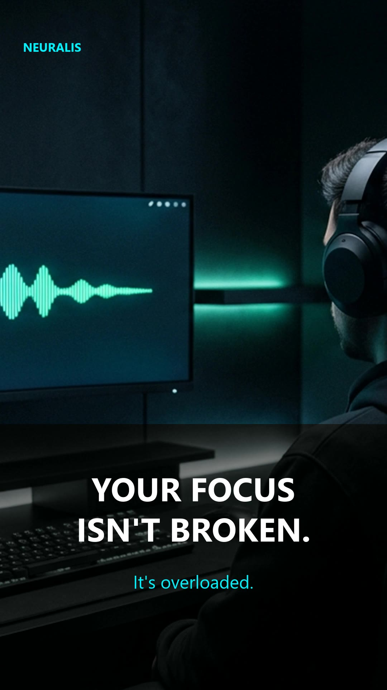
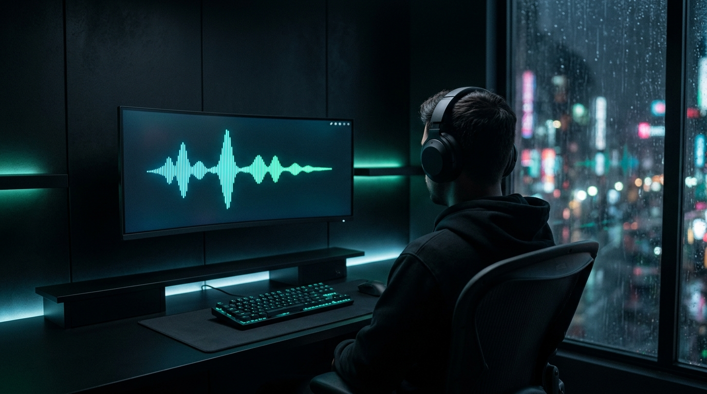
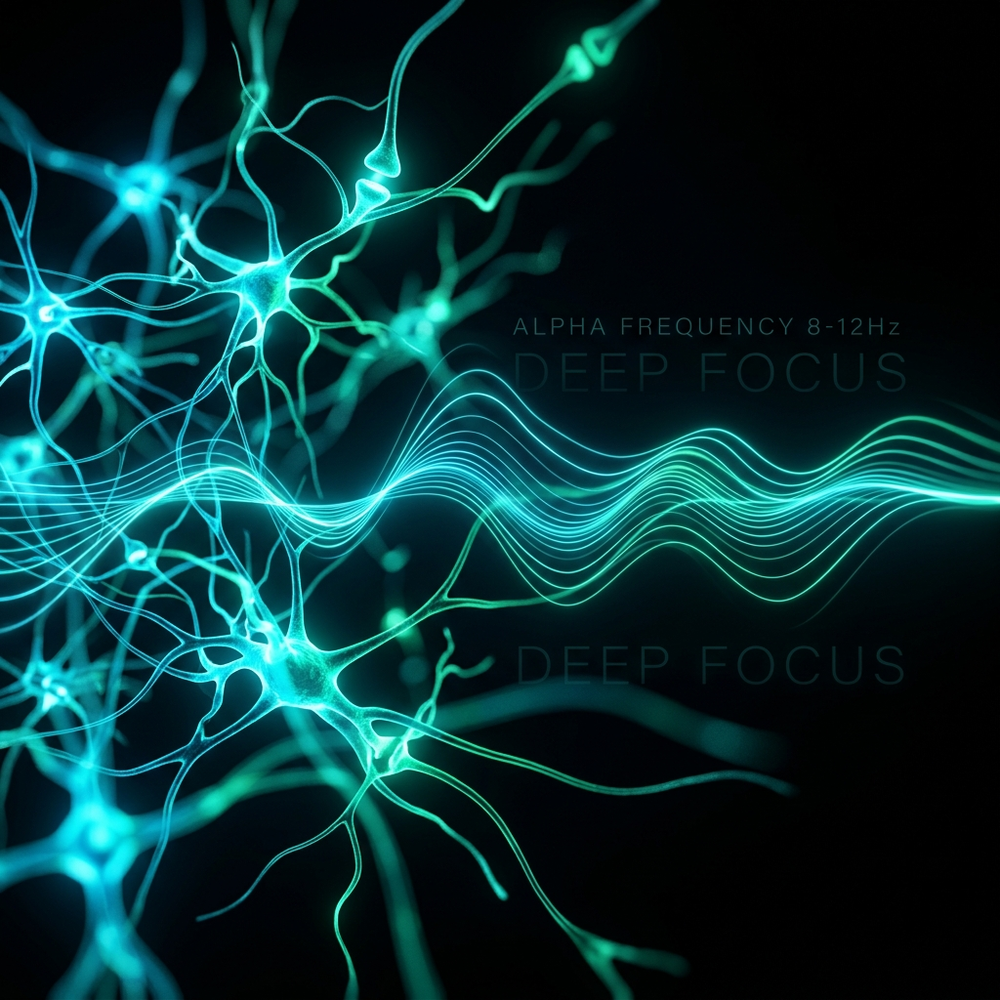
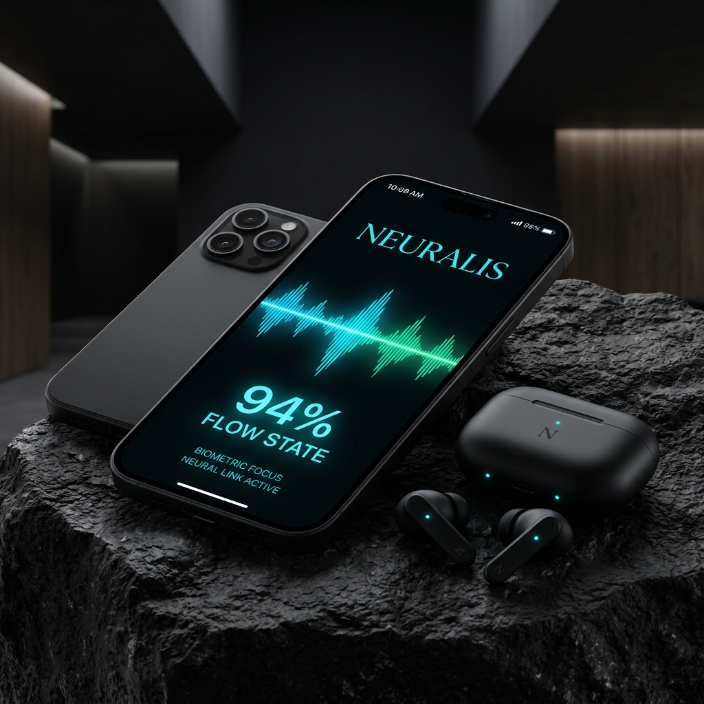
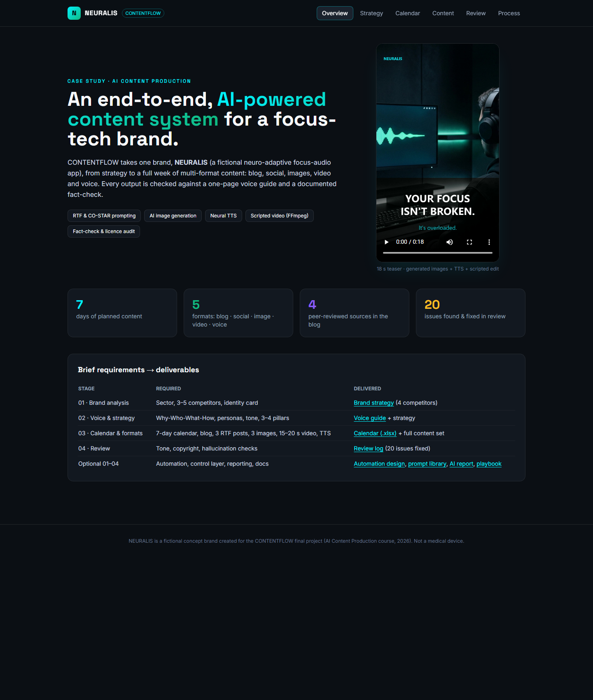
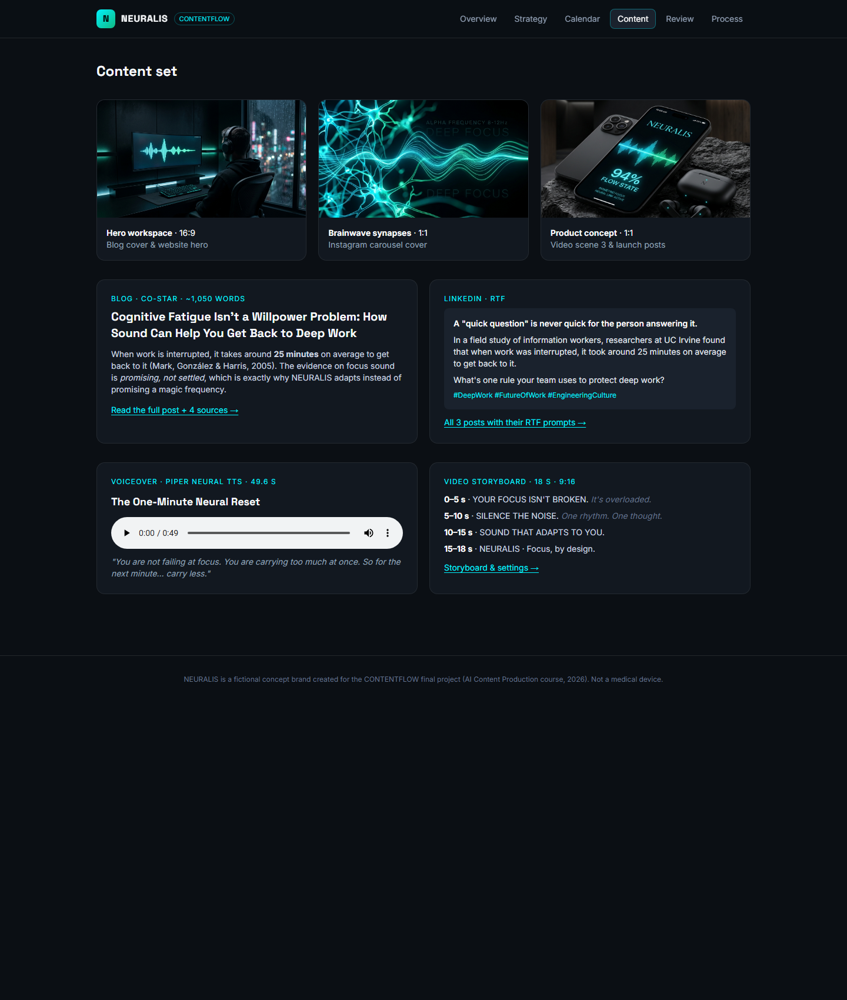
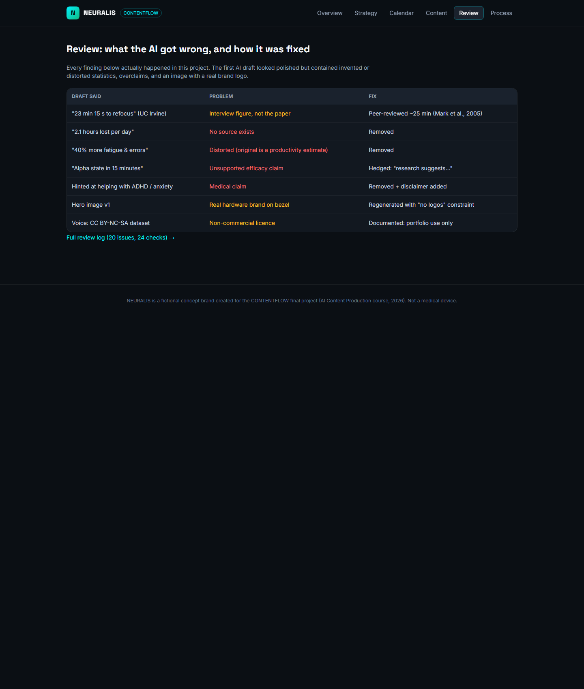

<div align="center">

# NEURALIS · CONTENTFLOW

**An end-to-end, AI-powered brand content system: from strategy to a full week of multi-format content, with a documented fact-check.**

*Final project · AI Content Production course · 2026*

[](assets/video/neuralis-teaser-9x16.mp4)

[**▶ Teaser video**](assets/video/neuralis-teaser-9x16.mp4) · [**🔊 Voiceover**](assets/audio/neural-reset-voiceover.mp3) · [**🌐 Showcase site**](index.html) · [**📊 Calendar (.xlsx)**](docs/content-calendar.xlsx)

</div>

---

## The project

The course brief: *a software company wants to reduce its marketing team's weekly content workload and keep its brand voice consistent across every channel. Design an end-to-end content production system using AI tools.*

I built that system for **NEURALIS**, a fictional software company that makes **neuro-adaptive focus audio** for knowledge workers. Focus tech is a demanding test for AI content: it needs a strong visual identity, multi-format storytelling and, above all, **scientific honesty**, because it's very easy for AI to make up neuroscience.

## What's inside

| Stage | Deliverable | File |
|---|---|---|
| **01 · Brand analysis & identity** | Sector, 4 competitors, identity card (values, palette, type, visual style) | [docs/01-brand-strategy.md](docs/01-brand-strategy.md) |
| **02 · Voice, audience & strategy** | Why-Who-What-How, 2 personas, 4 content pillars, **one-page voice guide** | [docs/02-brand-voice-guide.md](docs/02-brand-voice-guide.md) |
| **03 · Calendar** | 7-day plan with channel, format, pillar, rationale and KPI | [docs/03-content-calendar.md](docs/03-content-calendar.md) · [.xlsx](docs/content-calendar.xlsx) · [.csv](docs/content-calendar.csv) |
| **03 · Content set** | 1 SEO blog post | [content/blog-post.md](content/blog-post.md) |
| | 3 social posts written with **RTF** (LinkedIn, Instagram, X) | [content/social-posts.md](content/social-posts.md) |
| | 3 on-palette AI images | [assets/images/](assets/images/) |
| | 1 × 18 s vertical promo video | [assets/video/neuralis-teaser-9x16.mp4](assets/video/neuralis-teaser-9x16.mp4) |
| | 1 × TTS voiceover (49.6 s) | [assets/audio/neural-reset-voiceover.mp3](assets/audio/neural-reset-voiceover.mp3) |
| **04 · Review** | Tone, copyright and hallucination checks: **20 issues found and fixed** | [docs/04-content-review-log.md](docs/04-content-review-log.md) |
| *Optional 01 + 03* | Automation (Make/Zapier) and reporting design | [docs/08-automation-and-reporting.md](docs/08-automation-and-reporting.md) |
| *Optional 02* | AI output control layer (4 check fields) | [docs/04-content-review-log.md](docs/04-content-review-log.md) · [docs/08](docs/08-automation-and-reporting.md#automated-check-layer-optional-practice-02) |
| *Optional 04* | Prompt library · AI usage report · team playbook | [06](docs/06-prompt-library.md) · [05](docs/05-ai-usage-report.md) · [07](docs/07-team-playbook.md) |

## Visuals

| Hero workspace | Brainwave synapses | Product concept |
|---|---|---|
|  |  |  |

## The interesting part: what the AI got wrong

The first AI draft looked polished. It was also wrong in ways that would have embarrassed a real brand:

| Draft said | Reality | Fix |
|---|---|---|
| "23 min 15 s to refocus (UC Irvine study)" | Interview figure. The peer-reviewed paper reports ~25 min | Corrected + cited |
| "2.1 hours lost per day" | No source exists | Removed |
| "40% more fatigue and errors" | Distorted version of a productivity *estimate* | Removed |
| "Reach alpha state in 15 minutes" | Unsupported | Hedged ("research suggests…") |
| Hero image v1 | A real hardware brand name on the monitor | Regenerated with "no logos" constraint |

**The most effective prompt change in the project:** giving the model a **source whitelist** (*"Verified sources you MAY use: … Do NOT introduce other statistics."*). Full details in the [Review Log](docs/04-content-review-log.md) and [Prompt Library](docs/06-prompt-library.md).

## Toolchain

| Task | Tool |
|---|---|
| Strategy & copy | Google Gemini (draft) → Anthropic Claude (revision & fact-check), via the Antigravity agent IDE |
| Images | Antigravity built-in image generation (Google image model) |
| Voice | [Piper](https://github.com/rhasspy/piper) neural TTS, `en_US-ryan-high` (offline, open source) |
| Video & audio mix | FFmpeg, fully scripted ([`scripts/build_media.py`](scripts/build_media.py)) |
| Calendar | Python + openpyxl ([`scripts/build_calendar.py`](scripts/build_calendar.py)) |
| Showcase site | HTML + Tailwind CSS |

## Reproduce the media

```bash
pip install -r requirements.txt     # piper-tts, openpyxl
# FFmpeg must be on PATH
python scripts/build_calendar.py    # -> docs/content-calendar.xlsx + .csv
python scripts/build_media.py       # -> assets/audio/*.mp3 + assets/video/*.mp4
```

The first run downloads the Piper voice model (~120 MB) into `voices/` (git-ignored).

## Repository structure

```
├── README.md
├── index.html                  # showcase site (GitHub Pages ready)
├── docs/                       # strategy, voice guide, calendar, review, AI report, prompts, playbook, automation
├── content/                    # blog post, social posts, video & voiceover scripts
├── assets/
│   ├── images/                 # 3 AI-generated brand images
│   ├── video/                  # 18 s teaser + poster frame
│   ├── audio/                  # TTS voiceover
│   └── screenshots/            # showcase screenshots (content-set evidence)
├── presentation/               # Canva slide outline
└── scripts/                    # reproducible media + calendar builds
```

## Screenshots

| Overview | Content set | Review |
|---|---|---|
|  |  |  |

## Notes & licences
- **NEURALIS is a fictional brand.** It isn't affiliated with any real company with a similar name. Not a medical device.
- Competitor descriptions are based on public information and are meant as fair comparisons.
- **Voiceover:** Piper voice `en_US-ryan-high` was trained on a dataset licensed **CC BY-NC-SA 4.0**, so the audio is for non-commercial / portfolio use only.
- **Background audio** in the video and voiceover is synthesised by the build script. No third-party music.
- Code in `scripts/` and `index.html` is released under the [MIT License](LICENSE). Written content and images © the author, for portfolio use.
