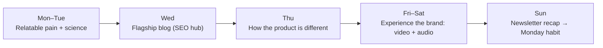

# 7-Day Content Calendar — NEURALIS

> **Deliverable 2 of 3** · Stage 03
> 📊 Spreadsheet versions: **[content-calendar.xlsx](content-calendar.xlsx)** · [content-calendar.csv](content-calendar.csv) (generated by [`scripts/build_calendar.py`](../scripts/build_calendar.py))

## Strategy behind the week

The week follows a simple **trust → value → product → habit** arc:

- The **Wednesday blog is the hub**: every other piece links back to it.
- Each day is mapped to one **content pillar** and matched to the **moment of the week** (planning on Monday, low energy on Friday, recovery on the weekend).
- Pillar mix across the week: Science 2 · Deep Work 2 · Product 1 · Sustainable Performance 2 (+ newsletter recap).

## Calendar

| Day | Channel | Format | Pillar | Topic / Hook | Persona | Why this, why today | KPI |
|---|---|---|---|---|---|---|---|
| **1 · Mon** | LinkedIn | Text post (RTF) | Deep Work | *The real cost of a "quick question"* | Deniz, Selin | Planning day: people are open to systems | Engagement ≥ 4%, saves |
| **2 · Tue** | Instagram | 5-slide carousel (RTF) | Science | *Your brain at work: beta, alpha, theta* | Deniz | Saveable visual explainer builds authority before the blog | Saves, shares |
| **3 · Wed** | Blog | SEO article (CO-STAR) | Science + Deep Work | *Cognitive fatigue isn't a willpower problem* | Deniz, Selin | Evergreen hub mid-week, when productivity search intent is high | Organic sessions, ≥ 3 min on page |
| **4 · Thu** | X / Twitter | 6-post thread (RTF) | Inside NEURALIS | *Why your focus playlist stops working after 30 min* | Deniz | Tech audience rewards depth; shows how we're different | Bookmarks, profile clicks |
| **5 · Fri** | Reels / Shorts / TikTok | 18 s vertical video | Sustainable Perf. | *Your focus isn't broken. It's overloaded.* | Deniz, Selin | Meets the Friday-afternoon energy dip | 3-s hold rate, link clicks |
| **6 · Sat** | Spotify / web audio | ~55 s TTS voiceover | Sustainable Perf. | *The One-Minute Neural Reset* | All | Weekend recovery; people hear the brand voice | Completion rate |
| **7 · Sun** | Email | Weekly digest | Mixed | *Three rules for a clearer Monday* | Selin, subscribers | Sunday planning moment closes the loop | Open & click rate |

## Format coverage (brief requirements)

| Required by brief | Delivered | Where |
|---|---|---|
| 1 SEO blog post | ✅ | [content/blog-post.md](../content/blog-post.md) |
| 3 social posts written with RTF | ✅ | [content/social-posts.md](../content/social-posts.md) |
| 3 on-palette images | ✅ | [assets/images/](../assets/images/) |
| 1 promo video, 15–20 s | ✅ 18 s | [assets/video/neuralis-teaser-9x16.mp4](../assets/video/neuralis-teaser-9x16.mp4) |
| 1 on-brand TTS voiceover | ✅ | [assets/audio/neural-reset-voiceover.mp3](../assets/audio/neural-reset-voiceover.mp3) |

> KPIs are **targets for a launch week**, not measured results. NEURALIS is a fictional brand and nothing has been published.
