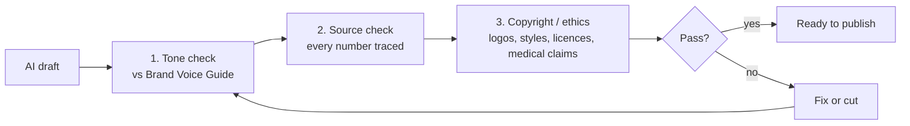

# Content Review Log: Brand Voice, Copyright & Hallucination Check

> **Stage 04 (mandatory):** every piece of content was checked for brand-voice consistency, copyright/ethics and hallucination risk before being marked ready.
> The four check fields follow the brief's optional *AI Output Control Layer*: `tone_consistency` · `keyword` · `copyright_check` · `source_verification`.

**Every finding below actually happened in this project.** The first draft (v1, written in Turkish) was AI-generated and contained real problems. This log records what was caught, why it mattered and how it was fixed.

---

## 1. Review process

---

## 2. Findings & fixes

### Text content

| # | Where | Finding (v1 draft) | Risk | Fix (v2) |
|---|---|---|---|---|
| T1 | Blog, LinkedIn | "**23 min 15 s** to refocus (UC Irvine)", presented as the study result | Misattribution | That figure comes from a 2006 interview, not the peer-reviewed paper. Replaced with the published figure: **~25 min** to resume interrupted work (Mark, González & Harris, 2005). |
| T2 | LinkedIn | "**2.1 hours** lost per day to context switching" | Hallucinated statistic | No traceable source found. **Removed.** |
| T3 | LinkedIn | "**40% increase** in fatigue and error risk" | Distorted statistic | The real "up to 40%" figure is David Meyer's estimate of *lost productive time*, not fatigue. Claim **removed** rather than re-framed. |
| T4 | Blog, Instagram, video | "Shifts your brain from Beta to **Alpha in 15 minutes**" | Unsupported efficacy claim | No evidence for a fixed time. Replaced with hedged language: "brain states blend… your environment can make settling easier". |
| T5 | Blog, X thread | "Phase-locking: sound **physically synchronises your neurons**" | Overclaim / pseudo-technical | **Removed.** Replaced with a hedged summary of the real research (Garcia-Argibay et al., 2019; Woods et al., 2024) plus an explicit "promising, not settled". |
| T6 | Voiceover | Background described as "**432 Hz** / 10 Hz isochronic tone" | Pseudoscience association | Replaced with a neutral, generated ambient pad. No frequency claims made. |
| T7 | Instagram | Hinted at helping with **ADHD / anxiety** | Medical claim (regulatory risk) | Removed everywhere. Added the hard rule "not a medical device" to the voice guide and the blog. |
| T8 | Social mockups | "**104,280 followers**" on a mock post | Fake social proof | Removed. |
| T9 | Automation doc | "**85.4% efficiency gain**", "24 h → 3.5 h" | Invented metric | Removed. The time saving is now framed as an *estimate to be measured*. |
| T10 | Competitor analysis | Endel described as "sleep/relax only, weak for focus" | Unfair / inaccurate | Endel has focus modes and wearable-based adaptation. Rewritten to name the real gap (no work-context or team layer). |
| T11 | Blog citation | Woods et al. (2024) author list was missing one author | Citation error | Checked against the publication and corrected. |

### Visual content

| # | Asset | Finding | Risk | Fix |
|---|---|---|---|---|
| V1 | Hero image **v1** | A **third-party hardware brand name** was legible on the monitor bezel, and the on-screen HUD showed garbled, duplicated values | Trademark + quality | **Rejected.** Regenerated v2 with the explicit constraint "no logos, no brand names, no text on devices". v2 passed. |
| V2 | `product-mobile-concept.jpg` | Generic phone, but its triple-camera layout resembles a real flagship model | Trade-dress (low) | **Accepted for concept use** (no logo visible). Must be replaced with a custom 3D render before any real ad. |
| V3 | `product-mobile-concept.jpg` | On-screen "**94% FLOW STATE**" metric | Could read as an efficacy claim | Accepted as a fictional UI mockup only. Never used in copy as a result. |
| V4 | `product-mobile-concept.jpg` | Wordmark on the phone is a serif font, not Space Grotesk | Brand inconsistency (minor) | Noted. The video and website use the correct typeface. |
| V5 | `brainwave-synapses.jpg` | Faint, duplicated background text ("DEEP FOCUS") | Generation artefact | Accepted as a stylistic texture. The text that *is* legible ("ALPHA FREQUENCY 8–12 Hz") is factually accurate. |
| V6 | All images | Prompt audit | Style imitation | No living artists, studios or brands named in any prompt ✅ |

### Audio / video

| # | Asset | Check | Result |
|---|---|---|---|
| A1 | Voiceover | Voice licence | Piper `en_US-ryan-high`, dataset **CC BY-NC-SA 4.0**. OK for portfolio/education, **not for commercial use.** Documented. |
| A2 | Voiceover | Voice cloning / impersonation | None. Stock open-source voice, no real person imitated ✅ |
| A3 | Video + audio | Music licensing | No third-party music. The ambient bed is synthesised in FFmpeg ✅ |
| A4 | Video | On-screen claims | "Sound that adapts to you": a product *design* statement, not an outcome claim ✅ |

### Brand-level

| # | Finding | Action |
|---|---|---|
| B1 | "Neuralis" is a fictional brand name. Similar names may exist commercially. | Every public asset is labelled *concept brand / portfolio project*. A trademark search would be required before real use. |
| B2 | v1 "AI usage report" listed tools that were **never used** (Midjourney, Runway, ElevenLabs, a specific Claude version) | Rewritten from scratch to reflect the real toolchain → [AI Usage Report](05-ai-usage-report.md). |
| B3 | v1 audit log contained *illustrative* examples written as if they were real events | Replaced by this log, which contains only real findings. |

---

## 3. Final status per content piece

| Content | `tone_consistency` | `keyword` | `copyright_check` | `source_verification` | Status |
|---|---|---|---|---|---|
| [Blog post](../content/blog-post.md) | ✅ | ✅ "cognitive fatigue" in title, H1, meta, intro | ✅ | ✅ 4 peer-reviewed sources | **Ready** |
| [LinkedIn post](../content/social-posts.md#post-1--linkedin) | ✅ | ✅ deep work / context switching | ✅ | ✅ Mark et al. 2005 | **Ready** |
| [Instagram carousel](../content/social-posts.md#post-2--instagram-carousel-5-slides) | ✅ | ✅ | ✅ | ✅ band ranges = standard EEG convention | **Ready** |
| [X thread](../content/social-posts.md#post-3--x--twitter-thread) | ✅ | ✅ | ✅ | ✅ Garcia-Argibay et al. 2019 | **Ready** |
| [3 images](../assets/images/) | ✅ palette | n/a | ✅ (V2 caveat) | n/a | **Ready (concept use)** |
| [Video](../assets/video/neuralis-teaser-9x16.mp4) | ✅ | ✅ signature line | ✅ | ✅ no claims | **Ready** |
| [Voiceover](../assets/audio/neural-reset-voiceover.mp3) | ✅ | ✅ signature line | ✅ NC licence | ✅ no claims | **Ready (non-commercial)** |

## 4. Lessons learned
1. **AI drafts tend to produce numbers that look like statistics.** None of the four statistics in the first draft (T1–T4) survived review unchanged. Rule now: *no number survives without a DOI or a primary URL.*
2. **Popular science figures drift from the paper.** "23 minutes" is everywhere online, but the peer-reviewed number is different. Always go to the primary source.
3. **Image models leak brand marks.** Add "no logos, no text on devices" to every product/scene prompt by default.
4. **"Free" isn't the same as "licence-free".** Open-source voices often carry non-commercial dataset licences.
