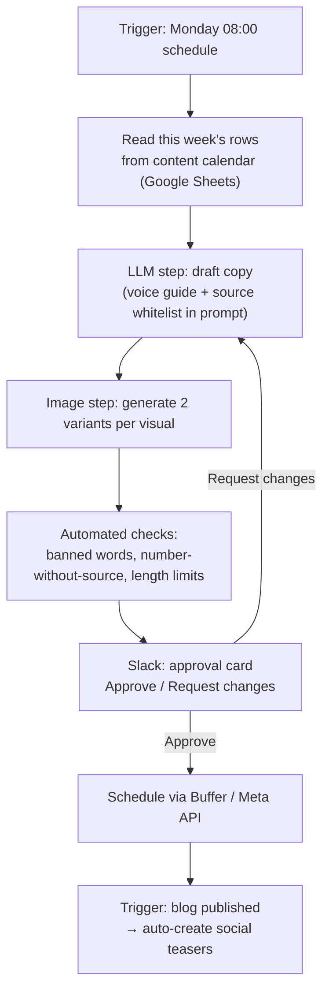

# Automation & Reporting Design *(optional practices 01 & 03)*

> **Status: design proposal.** These workflows are specified, not deployed. NEURALIS is fictional and has no live accounts. The design uses the six trigger/action examples from the brief.

## End-to-end flow (Make / Zapier / n8n)

## Workflow specs

| # | Workflow (from brief) | Trigger | Action(s) | Tools |
|---|---|---|---|---|
| 1 | **Auto blog sharing** | New blog post published (CMS webhook / RSS) | LLM writes LinkedIn + X teaser from the post → queued for approval | Webhook → OpenAI/Gemini module → Buffer |
| 2 | **Social scheduling** | Item marked *Approved* in Sheets | Send copy + image to Buffer / Meta Graph API at the calendar time | Google Sheets → Buffer |
| 3 | **Content approval alert** | AI draft created | Slack message with preview + Approve / Edit buttons | Slack Block Kit |
| 4 | **Trend alert** | Daily 08:00 | Search new papers on "attention", "auditory stimulation", "context switching" → 3-line summary to Slack | RSS (PubMed / arXiv) → LLM → Slack |
| 5 | **Weekly report** | Every Friday 09:00 | Pull channel metrics → summary table + 3 insights → email | Platform APIs → Sheets → LLM → Gmail |
| 6 | **Image resizing** | New approved image in Drive | Export 1:1, 4:5, 9:16, 16:9 crops | Cloudinary / Bannerbear |

## Automated check layer (optional practice 02)

Runs before every Slack approval card. It doesn't replace human review. It flags things for the reviewer.

| Check field | Rule | Example flag |
|---|---|---|
| `tone_consistency` | Banned-word list from the voice guide | "hack your brain" → ❌ |
| `keyword` | Primary keyword present in title/hook | Blog missing "cognitive fatigue" in meta → ⚠️ |
| `copyright_check` | Prompt contains "in the style of" or a proper name → flag. Image OCR finds a brand name → flag. | "in the style of [artist]" → ❌ |
| `source_verification` | Regex for numbers/percentages, each needs a URL/DOI within the same paragraph | "40% more productive" with no link → ❌ |

## Performance reporting design (optional practice 03)

| Report | Metrics | Source |
|---|---|---|
| **Engagement summary** | Likes + comments + shares + saves per post | Meta Graph API, LinkedIn API, X API |
| **Publishing performance** | Views / impressions per channel, 3-s hold rate (video), completion rate (audio) | Platform analytics |
| **Weekly system summary** | Pieces produced, pieces rejected in review (and why), top post, time spent | Calendar sheet + review log |

The time saved by automation should be **measured** (log hours in week 1 manually vs. week 4 automated). It isn't assumed here.
